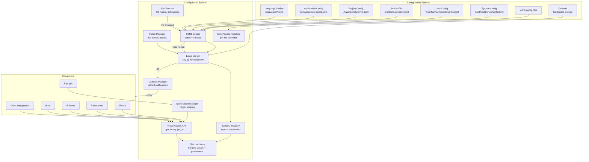

# Design Document: Configuration System (`ff-config`)

## 1. Overview

The `ff-config` crate is the **central settings management layer** for the FileForgeWorkbench workspace. It provides TOML-based configuration files, a layered override model with well-defined precedence, hot-reload without application restart, named user profiles, per-project overrides, EditorConfig integration, a typed access API with compile-time key definitions, plugin namespace scoping, and runtime-queryable schema validation.

### Purpose

- Load, merge, validate, watch, and serve configuration values to all platform subsystems and plugins
- Implement a fixed six-layer priority model: Defaults → System → User → Profile → Project → Workspace
- Provide typed, provenance-aware access to effective configuration values
- Support hot-reload with debounced file watching and atomic change application
- Manage named user profiles with runtime switching
- Integrate EditorConfig for per-file editor settings
- Enforce plugin namespace isolation and schema-based validation
- Expose a queryable schema registry for settings UI generation

### Position in Architecture

```
Wave 2 -- Platform Architecture (depends on Wave 0 ff-logging)

┌─────────────────────────────────────────────────────────┐
│                    Application Binary                     │
│                (ffwb / GUI shell -- ff-desktop)            │
├─────────────────────────────────────────────────────────┤
│  workflow-engine │ layout-and-docking │ document-model    │
│  edit-operations │ theme │ vfs │ all feature crates      │
├─────────────────────────────────────────────────────────┤
│  platform-core │ command-framework │ plugin-architecture │
│              ff-config (THIS CRATE) -- Wave 2              │
├─────────────────────────────────────────────────────────┤
│                     ff-logging (Wave 0)                   │
└─────────────────────────────────────────────────────────┘
```

### Design Constraints (Cross-Cutting)

- **FFW-ARCH-001 (Req 1)**: Configuration files are NOT accessed via VFS -- config uses direct filesystem access since it initializes before VFS
- **GUI Independence (Req 2)**: Zero GUI dependencies -- no egui, no windowing crate imports
- **Plugin Architecture (Req 3)**: Provides scoped `PluginConfigHandle` for plugin namespace isolation
- **Configuration Namespace (FFW Req 5)**: All keys unique, layered model, hot-reload, namespace prefixes, language profiles in separate files
- **Multi-Crate Workspace (Req 7)**: Crate at `crates/ff-config`
- **Error Message Standards (Req 8)**: Consistent `[config] operation: description` error format

### Upstream Dependencies

- `ff-logging` (Wave 0): Used for all diagnostic output (WARN on invalid files, DEBUG on unknown keys)

### Downstream Consumers

- `ff-core`: Reads startup parameters, manages config lifecycle via `ConfigProvider` trait
- `ff-command`: Reads shortcut bindings
- `ff-plugin`: Reads plugin-specific namespaces via `PluginConfigHandle`
- `ff-theme`: Reads appearance settings
- `ff-vfs`: Reads provider settings
- `ff-logging`: Reads log level settings (after initial bootstrap)
- All other subsystems: Read their respective namespace settings

---

## 2. Architecture

### High-Level Architecture Diagram



### Layer Placement

| Component | Responsibility |
|-----------|---------------|
| **TOML Loader** | Parse TOML files, report syntax errors, per-layer file mapping |
| **Layer Merger** | Recursive key-by-key merge across all six layers |
| **Schema Registry** | Store key definitions, types, defaults, constraints; runtime-queryable |
| **Effective Store** | Hold merged values with provenance metadata |
| **File Watcher** | Monitor config files, debounce events (500ms), trigger reload |
| **Profile Manager** | Discover, activate, deactivate, persist profile selection |
| **EditorConfig Resolver** | Parse .editorconfig files, resolve per-file properties |
| **Typed Access API** | Type-safe getters with validation and fallback to defaults |
| **Callback Manager** | Register and invoke reload callbacks for changed keys |
| **Namespace Manager** | Enforce plugin namespace scoping, reject out-of-scope access |

---

## 3. Module Structure

```
crates/ff-config/
├── Cargo.toml
├── src/
│   ├── lib.rs                  # Public API re-exports, crate docs
│   ├── value.rs                # ConfigValue enum, ConfigTable type
│   ├── layer.rs                # ConfigLayer enum, layer precedence ordering
│   ├── loader.rs               # TOML file loading, parse error handling
│   ├── merger.rs               # Recursive key-by-key layer merge logic
│   ├── store.rs                # EffectiveStore: merged values + provenance
│   ├── schema/
│   │   ├── mod.rs              # Schema module re-exports
│   │   ├── registry.rs         # SchemaRegistry: key registration, lookup
│   │   ├── entry.rs            # SchemaEntry: type, default, constraints, description
│   │   └── constraint.rs       # Constraint types: min, max, enum, regex
│   ├── access.rs               # Typed getter API: get_string, get_int, etc.
│   ├── provenance.rs           # Provenance metadata type
│   ├── watcher.rs              # OS-native file watcher, debounce logic
│   ├── reload.rs               # Hot-reload orchestration, atomic apply
│   ├── callback.rs             # ReloadCallback registration and invocation
│   ├── profile.rs              # Profile manager: list, switch, persist
│   ├── editorconfig/
│   │   ├── mod.rs              # EditorConfig module re-exports
│   │   ├── parser.rs           # .editorconfig file parser
│   │   └── resolver.rs         # Per-file property resolution (path traversal)
│   ├── namespace.rs            # Plugin namespace scoping and enforcement
│   ├── plugin_handle.rs        # PluginConfigHandle: scoped read/write API
│   ├── paths.rs                # Platform-specific config file path resolution
│   ├── keys.rs                 # Compile-time const key definitions for core settings
│   ├── init.rs                 # Initialization sequence, directory detection
│   └── error.rs                # ConfigError enum
└── tests/
    ├── layer_merge_tests.rs    # Layer merge property tests
    ├── schema_tests.rs         # Schema validation property tests
    ├── reload_tests.rs         # Hot-reload property tests
    ├── profile_tests.rs        # Profile switching property tests
    ├── editorconfig_tests.rs   # EditorConfig resolution property tests
    ├── namespace_tests.rs      # Plugin namespace isolation tests
    └── integration.rs          # End-to-end initialization and access tests
```

---

## 4. Key Data Models

### ConfigValue

```rust
/// Represents any configuration value. Maps to TOML value types.
/// Addresses: Requirement 1, criterion 4; Requirement 7, criterion 7
#[derive(Debug, Clone, PartialEq)]
#[non_exhaustive]
pub enum ConfigValue {
    String(String),
    Integer(i64),
    Float(f64),
    Boolean(bool),
    Array(Vec<ConfigValue>),
    Table(ConfigTable),
}
```

### ConfigTable

```rust
/// A table of key-value pairs within a configuration namespace.
/// Addresses: Requirement 1, criterion 3
pub type ConfigTable = std::collections::BTreeMap<String, ConfigValue>;
```

### ConfigLayer

```rust
/// The fixed set of configuration layers in ascending priority order.
/// Addresses: Requirement 2, criteria 1/4
#[derive(Debug, Clone, Copy, PartialEq, Eq, PartialOrd, Ord, Hash)]
#[non_exhaustive]
pub enum ConfigLayer {
    /// Hardcoded defaults from schema definitions (lowest priority)
    Defaults = 0,
    /// System-wide configuration file
    System = 1,
    /// Per-user configuration file
    User = 2,
    /// Active named profile overlay
    Profile = 3,
    /// Project-level configuration (.ffworkbench/config.toml)
    Project = 4,
    /// Workspace-level configuration (highest file-based priority)
    Workspace = 5,
}
```

### Provenance

```rust
/// Metadata indicating where an effective value came from.
/// Addresses: Requirement 2, criterion 3
#[derive(Debug, Clone, PartialEq, Eq)]
pub struct Provenance {
    /// Which layer provided this value
    pub layer: ConfigLayer,
    /// The file path that sourced this value (None for Defaults layer)
    pub source_file: Option<PathBuf>,
}
```

### EffectiveValue

```rust
/// A resolved configuration value paired with its provenance.
/// Addresses: Requirement 2, criteria 2/3
#[derive(Debug, Clone)]
pub struct EffectiveValue {
    /// The final resolved value after layer merge
    pub value: ConfigValue,
    /// Which layer provided this value
    pub provenance: Provenance,
}
```

### SchemaEntry

```rust
/// Definition of a single configuration key in the schema.
/// Addresses: Requirement 9, criteria 1/2/3
#[derive(Debug, Clone)]
pub struct SchemaEntry {
    /// Dot-separated key path (e.g., "editor.tab_size")
    pub key: String,
    /// Expected value type
    pub value_type: ValueType,
    /// Default value (required for all schema entries)
    pub default: ConfigValue,
    /// Human-readable description for settings UI
    pub description: String,
    /// Optional validation constraints
    pub constraints: Option<Constraints>,
}
```

### ValueType

```rust
/// Declared type for a configuration key.
/// Addresses: Requirement 1, criterion 4; Requirement 9, criterion 2
#[derive(Debug, Clone, Copy, PartialEq, Eq)]
pub enum ValueType {
    String,
    Integer,
    Float,
    Boolean,
    Array,
    Table,
}
```

### Constraints

```rust
/// Optional validation constraints for a schema entry.
/// Addresses: Requirement 7, criteria 4/5/6; Requirement 9, criterion 3
#[derive(Debug, Clone)]
pub struct Constraints {
    /// Minimum value (for Integer and Float types)
    pub min: Option<f64>,
    /// Maximum value (for Integer and Float types)
    pub max: Option<f64>,
    /// Set of allowed string or integer values (enum constraint)
    pub allowed_values: Option<Vec<ConfigValue>>,
    /// Regex pattern for string validation
    pub pattern: Option<String>,
}
```

### LayerData

```rust
/// The parsed content of a single configuration layer.
/// Internal to the merge engine.
pub(crate) struct LayerData {
    /// Which layer this data belongs to
    pub layer: ConfigLayer,
    /// Source file path (None for Defaults)
    pub source: Option<PathBuf>,
    /// The parsed table of key-value pairs (recursive)
    pub values: ConfigTable,
}
```

### ReloadEvent

```rust
/// Describes a set of configuration changes detected during hot-reload.
/// Addresses: Requirement 3, criteria 3/5
#[derive(Debug, Clone)]
pub struct ReloadEvent {
    /// Keys whose effective value changed
    pub changed_keys: Vec<String>,
    /// The layer that was reloaded
    pub source_layer: ConfigLayer,
    /// Timestamp of the reload
    pub timestamp: std::time::Instant,
}
```

### UserProfile

```rust
/// Metadata for a discovered user profile.
/// Addresses: Requirement 4, criteria 1/7
#[derive(Debug, Clone, PartialEq, Eq)]
pub struct UserProfile {
    /// Profile name (derived from filename without extension)
    pub name: String,
    /// Path to the profile's TOML file
    pub path: PathBuf,
}
```

### EditorConfigProperties

```rust
/// Resolved EditorConfig properties for a specific file.
/// Addresses: Requirement 6, criteria 1/2
#[derive(Debug, Clone, Default)]
pub struct EditorConfigProperties {
    pub indent_style: Option<IndentStyle>,
    pub indent_size: Option<u32>,
    pub tab_width: Option<u32>,
    pub end_of_line: Option<EndOfLine>,
    pub charset: Option<Charset>,
    pub trim_trailing_whitespace: Option<bool>,
    pub insert_final_newline: Option<bool>,
}

#[derive(Debug, Clone, Copy, PartialEq, Eq)]
pub enum IndentStyle {
    Space,
    Tab,
}

#[derive(Debug, Clone, Copy, PartialEq, Eq)]
pub enum EndOfLine {
    Lf,
    CrLf,
    Cr,
}

#[derive(Debug, Clone, Copy, PartialEq, Eq)]
pub enum Charset {
    Utf8,
    Utf8Bom,
    Latin1,
    Utf16Be,
    Utf16Le,
}
```

### ConfigSystem (internal runtime state)

```rust
/// The runtime state of the configuration system. Not public.
/// Holds all layers, the schema, the watcher, and the callback registry.
pub(crate) struct ConfigSystem {
    /// Parsed data for each layer
    layers: Vec<LayerData>,
    /// The merged effective store
    store: EffectiveStore,
    /// The schema registry
    schema: SchemaRegistry,
    /// File watcher handle
    watcher: Option<FileWatcherHandle>,
    /// Registered reload callbacks
    callbacks: CallbackRegistry,
    /// Currently active profile (if any)
    active_profile: Option<String>,
    /// Profile manager
    profiles: ProfileManager,
    /// Plugin namespace registry
    namespaces: NamespaceRegistry,
}
```

---

## 5. Public API Surface

### Initialization and Lifecycle

```rust
/// Initialize the configuration system. Loads all available layers,
/// validates against the schema, starts the file watcher.
/// Must be called after ff-logging is initialized.
///
/// Addresses: Requirement 1, criteria 1/2; Requirement 2, criterion 1
pub fn init(options: ConfigInitOptions) -> Result<ConfigHandle, ConfigError>;

/// Options for initializing the configuration system.
pub struct ConfigInitOptions {
    /// Override the project root directory (auto-detected if None)
    pub project_root: Option<PathBuf>,
    /// Override the workspace root directory (auto-detected if None)
    pub workspace_root: Option<PathBuf>,
    /// Whether to start file watching (default: true)
    pub enable_hot_reload: bool,
}

/// Handle providing access to the initialized configuration system.
/// Thread-safe, clonable, and shareable across subsystems.
///
/// Addresses: Requirement 7, criterion 1
#[derive(Clone)]
pub struct ConfigHandle {
    inner: Arc<RwLock<ConfigSystem>>,
}

/// Shut down the configuration system. Stops file watching,
/// deregisters all callbacks.
pub fn shutdown(handle: &ConfigHandle);
```

### Typed Access API

```rust
impl ConfigHandle {
    /// Get a string value for the given key.
    /// Returns schema default if value is missing, wrong type, or fails validation.
    ///
    /// Addresses: Requirement 7, criteria 1/5/6
    pub fn get_string(&self, key: &str) -> Result<String, ConfigError>;

    /// Get an integer value for the given key.
    /// Addresses: Requirement 7, criteria 1/5/6
    pub fn get_int(&self, key: &str) -> Result<i64, ConfigError>;

    /// Get a float value for the given key.
    /// Addresses: Requirement 7, criteria 1/5/6
    pub fn get_float(&self, key: &str) -> Result<f64, ConfigError>;

    /// Get a boolean value for the given key.
    /// Addresses: Requirement 7, criteria 1/5/6
    pub fn get_bool(&self, key: &str) -> Result<bool, ConfigError>;

    /// Get an array value for the given key.
    /// Addresses: Requirement 7, criterion 1
    pub fn get_array(&self, key: &str) -> Result<Vec<ConfigValue>, ConfigError>;

    /// Get a table value for the given key.
    /// Addresses: Requirement 7, criterion 1
    pub fn get_table(&self, key: &str) -> Result<ConfigTable, ConfigError>;

    /// Get the generic effective value without type coercion.
    /// Addresses: Requirement 7, criterion 7
    pub fn get(&self, key: &str) -> Result<ConfigValue, ConfigError>;

    /// Get the effective value with full provenance information.
    /// Addresses: Requirement 2, criterion 3
    pub fn get_with_provenance(&self, key: &str) -> Result<EffectiveValue, ConfigError>;
}
```

### Hot-Reload and Callbacks

```rust
/// A type-erased callback invoked when watched configuration keys change.
/// Addresses: Requirement 3, criterion 4
pub type ReloadCallback = Box<dyn Fn(&ReloadEvent) + Send + Sync>;

/// Handle returned when registering a callback; used for deregistration.
#[derive(Debug, Clone, PartialEq, Eq, Hash)]
pub struct CallbackHandle(u64);

impl ConfigHandle {
    /// Register a reload callback for specific keys. The callback is invoked
    /// when any of the specified keys' effective values change during hot-reload.
    ///
    /// Addresses: Requirement 3, criteria 3/4
    pub fn on_reload(
        &self,
        keys: &[&str],
        callback: ReloadCallback,
    ) -> CallbackHandle;

    /// Deregister a previously registered reload callback.
    pub fn remove_callback(&self, handle: CallbackHandle);

    /// Force a manual reload of all configuration files. Useful for testing
    /// or when a subsystem knows its config has changed externally.
    ///
    /// Addresses: Requirement 3, criteria 2/3
    pub fn reload(&self) -> Result<ReloadEvent, ConfigError>;
}
```

### Profile Management

```rust
impl ConfigHandle {
    /// List all available user profiles by scanning the profiles directory.
    ///
    /// Addresses: Requirement 4, criterion 7
    pub fn list_profiles(&self) -> Vec<UserProfile>;

    /// Get the currently active profile name, if any.
    pub fn active_profile(&self) -> Option<String>;

    /// Switch to a named profile. Recomputes effective values and invokes
    /// reload callbacks for changed keys. Pass None to deactivate.
    ///
    /// Addresses: Requirement 4, criteria 3/4
    pub fn set_active_profile(&self, profile_name: Option<&str>) -> Result<ReloadEvent, ConfigError>;
}
```

### Project Layer Management

```rust
impl ConfigHandle {
    /// Load project-layer configuration from the given project root.
    /// Called when a project is opened.
    ///
    /// Addresses: Requirement 5, criteria 1/2
    pub fn load_project(&self, project_root: &Path) -> Result<ReloadEvent, ConfigError>;

    /// Unload the project-layer configuration. Called when a project is closed.
    /// Recomputes effective values and notifies callbacks.
    ///
    /// Addresses: Requirement 5, criterion 6
    pub fn unload_project(&self) -> Result<ReloadEvent, ConfigError>;
}
```

### EditorConfig Resolution

```rust
impl ConfigHandle {
    /// Resolve EditorConfig properties for a specific file path.
    /// Traverses parent directories from the file up to a root = true file.
    /// Returns only the properties defined by EditorConfig; None fields mean
    /// "not specified by EditorConfig, use normal config resolution."
    ///
    /// Addresses: Requirement 6, criteria 1/2/3/4/5
    pub fn resolve_editorconfig(&self, file_path: &Path) -> EditorConfigProperties;
}
```

### Schema Registry

```rust
impl ConfigHandle {
    /// Register a new schema entry. Called by core subsystems at startup
    /// and by plugins during initialization.
    ///
    /// Addresses: Requirement 9, criteria 1/7
    pub fn register_schema(&self, entry: SchemaEntry) -> Result<(), ConfigError>;

    /// Register multiple schema entries at once.
    pub fn register_schema_batch(&self, entries: Vec<SchemaEntry>) -> Result<(), ConfigError>;

    /// Query the schema: get the entry for a specific key.
    ///
    /// Addresses: Requirement 9, criterion 5
    pub fn get_schema_entry(&self, key: &str) -> Option<&SchemaEntry>;

    /// Enumerate all registered schema keys with their metadata.
    /// Used by settings UI for auto-generation.
    ///
    /// Addresses: Requirement 9, criterion 5
    pub fn list_schema_entries(&self) -> Vec<&SchemaEntry>;

    /// Remove schema entries for a specific namespace prefix.
    /// Called during plugin unload.
    ///
    /// Addresses: Requirement 8, criterion 6
    pub fn deregister_schema(&self, prefix: &str);
}
```

### Plugin Configuration Scoping

```rust
/// A scoped configuration handle provided to plugins via PluginContext.
/// Restricts access to the plugin's own namespace only.
///
/// Addresses: Requirement 8, criteria 1/2/3
pub struct PluginConfigHandle {
    /// The plugin's namespace prefix (e.g., "plugins.sql-viewer")
    namespace: String,
    /// Reference to the underlying config system
    inner: ConfigHandle,
}

impl PluginConfigHandle {
    /// Get a string value within the plugin's namespace.
    /// Key is relative to the plugin namespace (e.g., "max_rows" → "plugins.sql-viewer.max_rows").
    ///
    /// Addresses: Requirement 8, criterion 2
    pub fn get_string(&self, key: &str) -> Result<String, ConfigError>;

    /// Get an integer value within the plugin's namespace.
    pub fn get_int(&self, key: &str) -> Result<i64, ConfigError>;

    /// Get a float value within the plugin's namespace.
    pub fn get_float(&self, key: &str) -> Result<f64, ConfigError>;

    /// Get a boolean value within the plugin's namespace.
    pub fn get_bool(&self, key: &str) -> Result<bool, ConfigError>;

    /// Get any value within the plugin's namespace.
    pub fn get(&self, key: &str) -> Result<ConfigValue, ConfigError>;

    /// Write a value to the plugin's namespace (persists to user-layer file).
    ///
    /// Addresses: Requirement 8, criterion 2
    pub fn set(&self, key: &str, value: ConfigValue) -> Result<(), ConfigError>;

    /// Register a reload callback for keys in this plugin's namespace.
    ///
    /// Addresses: Requirement 8, criterion 5
    pub fn on_reload(&self, keys: &[&str], callback: ReloadCallback) -> CallbackHandle;

    /// Returns the plugin's namespace prefix.
    pub fn namespace(&self) -> &str;
}

/// Create a scoped plugin config handle. Called by the plugin architecture
/// when constructing PluginContext.
///
/// Addresses: Requirement 8, criteria 1/2
pub fn create_plugin_config_handle(
    config: &ConfigHandle,
    plugin_name: &str,
) -> Result<PluginConfigHandle, ConfigError>;
```

### ConfigProvider Trait Implementation

```rust
/// ff-config implements the ConfigProvider trait defined by ff-core,
/// bridging the configuration system to the core layer.
///
/// Addresses: Integration with ff-core (see platform-core design §5)
impl ff_core::ConfigProvider for ConfigHandle {
    fn get<T: serde::de::DeserializeOwned>(&self, namespace: &str, key: &str) -> Option<T>;
    fn get_namespace(&self, namespace: &str) -> Option<toml::Value>;
}
```

### Compile-Time Key Definitions

```rust
/// Compile-time key constants for core settings.
/// Consumers use these instead of string literals to catch typos at compile time.
///
/// Addresses: Requirement 7, criterion 2
pub mod keys {
    // Editor settings
    pub const EDITOR_TAB_SIZE: &str = "editor.tab_size";
    pub const EDITOR_INDENT_STYLE: &str = "editor.indent_style";
    pub const EDITOR_LINE_ENDINGS: &str = "editor.line_endings";
    pub const EDITOR_TRIM_TRAILING_WHITESPACE: &str = "editor.trim_trailing_whitespace";
    pub const EDITOR_INSERT_FINAL_NEWLINE: &str = "editor.insert_final_newline";

    // Logging settings
    pub const LOGGING_LEVEL: &str = "logging.level";
    pub const LOGGING_DIRECTORY: &str = "logging.directory";
    pub const LOGGING_MAX_FILE_SIZE_MB: &str = "logging.max_file_size_mb";
    pub const LOGGING_MAX_RETAINED_FILES: &str = "logging.max_retained_files";

    // Theme settings
    pub const THEME_ACTIVE: &str = "theme.active";
    pub const THEME_FONT_SIZE: &str = "theme.font_size";

    // VFS settings
    pub const VFS_DEFAULT_PROVIDER: &str = "vfs.default_provider";
}
```

---

## 6. Error Types

```rust
/// Errors originating from the ff-config crate.
/// Formatted per Error Message Standards: `[config] operation: description`
///
/// Addresses: Cross-cutting Requirement 8
#[derive(Debug, thiserror::Error)]
#[non_exhaustive]
pub enum ConfigError {
    /// Configuration file contains invalid TOML syntax
    /// Addresses: Requirement 1, criterion 6
    #[error("[config] parse: invalid TOML in '{path}': {detail}")]
    ParseError {
        path: PathBuf,
        detail: String,
    },

    /// A configuration key is not defined in any layer and has no schema default
    /// Addresses: Requirement 2, criterion 6
    #[error("[config] get: key '{key}' is undefined (no schema entry and not set in any layer)")]
    UndefinedKey {
        key: String,
    },

    /// Type mismatch between requested type and stored value
    /// Addresses: Requirement 7, criterion 5
    #[error("[config] get: type mismatch for key '{key}' -- expected {expected}, found {actual}")]
    TypeMismatch {
        key: String,
        expected: ValueType,
        actual: ValueType,
    },

    /// Value failed schema validation constraints
    /// Addresses: Requirement 7, criterion 6; Requirement 9, criterion 4
    #[error("[config] validate: key '{key}' value {value} violates constraint: {constraint}")]
    ValidationFailed {
        key: String,
        value: String,
        constraint: String,
    },

    /// Plugin attempted to access a key outside its namespace
    /// Addresses: Requirement 8, criterion 3
    #[error("[config] namespace: plugin '{plugin}' cannot access key '{key}' (outside namespace '{namespace}')")]
    NamespaceViolation {
        plugin: String,
        key: String,
        namespace: String,
    },

    /// Plugin name contains invalid characters
    /// Addresses: Requirement 8, criterion 1
    #[error("[config] namespace: invalid plugin name '{name}' -- must be lowercase ASCII, hyphens, and digits only")]
    InvalidPluginName {
        name: String,
    },

    /// Plugin attempted to register keys in a reserved core namespace
    /// Addresses: Requirement 8, criterion 7
    #[error("[config] namespace: plugin '{plugin}' cannot register keys in reserved namespace '{namespace}'")]
    ReservedNamespace {
        plugin: String,
        namespace: String,
    },

    /// Profile file not found or unreadable
    /// Addresses: Requirement 4, criterion 6
    #[error("[config] profile: profile '{name}' not found at '{path}'")]
    ProfileNotFound {
        name: String,
        path: PathBuf,
    },

    /// File watcher initialization failed
    #[error("[config] watcher: failed to initialize file watcher: {reason}")]
    WatcherError {
        reason: String,
    },

    /// I/O error reading configuration file
    /// Addresses: Requirement 5, criterion 7
    #[error("[config] io: failed to read '{path}': {source}")]
    Io {
        path: PathBuf,
        source: std::io::Error,
    },

    /// Schema registration conflict (duplicate key with different type)
    #[error("[config] schema: key '{key}' already registered with type {existing_type:?}, cannot re-register as {new_type:?}")]
    SchemaConflict {
        key: String,
        existing_type: ValueType,
        new_type: ValueType,
    },

    /// EditorConfig file parse error
    /// Addresses: Requirement 6, criterion 6
    #[error("[config] editorconfig: parse error in '{path}': {detail}")]
    EditorConfigParseError {
        path: PathBuf,
        detail: String,
    },
}
```

---

## 7. Integration Points

### With `ff-logging` (Foundation Layer -- upstream)

- **Dependency direction**: ff-config depends on ff-logging
- **API consumed**: `log_warn!`, `log_debug!`, `log_info!` macros
- **Usage**: Emit WARN on parse errors (Req 1.6), type mismatches (Req 7.5), validation failures (Req 7.6, 9.4), profile not found (Req 4.6), EditorConfig errors (Req 6.6). Emit DEBUG on unknown keys (Req 9.6)
- **Bootstrap**: ff-config initializes **after** ff-logging is already active. No circular dependency.

### With `ff-core` (Core Layer -- peer, downstream consumer)

- **Dependency direction**: ff-core depends on ff-config via the `ConfigProvider` trait
- **API exposed**: `ConfigHandle` implements `ff_core::ConfigProvider`
- **Initialization**: ff-core calls `ff_config::init()` as the second subsystem in its startup sequence (after logging). The returned `ConfigHandle` is stored in the ServiceRegistry
- **Hot-reload integration**: When ff-config detects file changes, it invokes registered callbacks. ff-core subscribes to config changes and dispatches `ConfigReloaded` through its Event Bus
- **Shutdown**: ff-core calls `ff_config::shutdown()` during its ordered teardown

### With `ff-plugin` (Core Layer -- peer, downstream consumer)

- **Dependency direction**: ff-plugin depends on ff-config for `PluginConfigHandle`
- **API exposed**: `create_plugin_config_handle(config, plugin_name)` creates a scoped handle
- **Usage**: When ff-plugin constructs a `PluginContext`, it calls `create_plugin_config_handle` to provide each plugin with isolated config access
- **Plugin defaults**: During plugin initialization, ff-plugin calls `register_schema_batch()` with the plugin's declared default configuration values (Req 8.4)
- **Plugin unload**: During plugin shutdown, ff-plugin calls `deregister_schema(prefix)` to remove the plugin's schema entries (Req 8.6)

### With `ff-command` (Core Layer -- peer, downstream consumer)

- **Dependency direction**: ff-command depends on ff-config for reading keybinding settings
- **API consumed**: `ConfigHandle::get_table("commands.keybindings")`
- **Hot-reload**: ff-command registers reload callbacks for its configuration keys

### With `ff-theme` (downstream consumer)

- **Dependency direction**: ff-theme depends on ff-config for appearance settings
- **API consumed**: `ConfigHandle::get_string(keys::THEME_ACTIVE)`, font size, color scheme
- **Hot-reload**: Theme changes applied immediately via reload callbacks

### With `ff-vfs` (downstream consumer)

- **Dependency direction**: ff-vfs depends on ff-config for provider settings
- **API consumed**: `ConfigHandle::get_string(keys::VFS_DEFAULT_PROVIDER)`, provider-specific tables

### With `edit-operations` and `document-model` (downstream consumers)

- **Dependency direction**: These crates depend on ff-config for editor settings
- **API consumed**: `ConfigHandle::get_int(keys::EDITOR_TAB_SIZE)`, indent style, line endings
- **EditorConfig integration**: These crates call `resolve_editorconfig(file_path)` to get per-file overrides that take precedence over normal config (Req 6.3)

### Dependency Direction Summary

```
ff-logging ← ff-config ← ff-core
                        ← ff-command
                        ← ff-plugin
                        ← ff-theme
                        ← ff-vfs
                        ← edit-operations
                        ← document-model
                        ← (all other subsystems)
```

`ff-config` depends on NO other workspace crates except `ff-logging`. External dependencies:
- `toml` -- TOML parsing
- `notify` -- Cross-platform file watching (inotify, ReadDirectoryChangesW, FSEvents)
- `dirs` -- Platform-appropriate default directories
- `regex` -- Pattern validation for string constraints
- `thiserror` -- Error type derivation
- `serde` / `serde_derive` -- Serialization for ConfigProvider trait
- `proptest` -- Property-based testing (dev-dependency only)

---

## 8. Configuration (Meta)

The configuration system configures itself using a minimal bootstrap. Since ff-config cannot read its own settings before it initializes, it uses hardcoded defaults and environment variables for its own operational parameters.

### Bootstrap Configuration

| Parameter | Source | Default |
|-----------|--------|---------|
| System config path | Platform convention | `/etc/ffworkbench/config.toml` (Linux), `%PROGRAMDATA%\FFWorkbench\config.toml` (Windows) |
| User config path | Platform convention | `~/.config/ffworkbench/config.toml` (Linux), `%APPDATA%\FFWorkbench\config.toml` (Windows) |
| User profiles dir | Platform convention | `~/.config/ffworkbench/profiles/` (Linux), `%APPDATA%\FFWorkbench\profiles\` (Windows) |
| Languages dir | Relative to config | `languages/` subdirectory of user config dir |
| Debounce window | Hardcoded | 500 milliseconds (Req 3.7) |
| Hot-reload detection | Hardcoded | Within 2 seconds (Req 3.2) |
| Watcher enabled | `ConfigInitOptions` | `true` |

### File Layout

```
System layer:
  /etc/ffworkbench/config.toml          (Linux)
  %PROGRAMDATA%\FFWorkbench\config.toml (Windows)
  /Library/Application Support/FFWorkbench/config.toml (macOS)

User layer:
  ~/.config/ffworkbench/config.toml          (Linux)
  %APPDATA%\FFWorkbench\config.toml          (Windows)
  ~/Library/Application Support/FFWorkbench/config.toml (macOS)

Profiles:
  ~/.config/ffworkbench/profiles/mainframe.toml
  ~/.config/ffworkbench/profiles/web-dev.toml

Languages:
  ~/.config/ffworkbench/languages/rust.toml
  ~/.config/ffworkbench/languages/cobol.toml

Project layer:
  <project-root>/.ffworkbench/config.toml

Workspace layer:
  <workspace-root>/config.toml
```

### Active Profile Persistence

The currently active profile name is persisted in the user-layer config file under a special key:

```toml
[_session]
active_profile = "mainframe"
```

This key is read during initialization to auto-activate the last-used profile (Req 4.5).

---

## 9. Concurrency Model

### Thread-Safety Approach

| Component | Mechanism | Rationale |
|-----------|-----------|-----------|
| ConfigHandle | `Arc<RwLock<ConfigSystem>>` | Multiple readers, single writer during reload |
| Effective Store reads | `RwLock` read guard | Concurrent reads from any thread without blocking |
| Hot-reload writes | `RwLock` write guard (brief) | Atomic swap of effective values during reload |
| File watcher | Dedicated OS thread (via `notify` crate) | Watches filesystem events independently |
| Callback invocation | Called under read guard release | Callbacks run after state update, no lock held |
| Schema registry | Protected by same `RwLock` | Schema grows during plugin init, then mostly reads |

### Reload Concurrency Model

```
┌──────────────┐       ┌──────────────────────────┐       ┌──────────────────┐
│ Watcher Thread│──────▶│ Debounce Timer (500ms)   │──────▶│ Reload Executor   │
│ (notify crate)│       │ coalesce rapid events    │       │ (same or pool thd)│
└──────────────┘       └──────────────────────────┘       └──────────────────┘
                                                                    │
                                                                    ▼
                                                          ┌──────────────────┐
                                                          │ 1. Re-read file   │
                                                          │ 2. Parse TOML     │
                                                          │ 3. Validate schema│
                                                          │ 4. Acquire write  │
                                                          │    lock (brief)   │
                                                          │ 5. Swap layer data│
                                                          │ 6. Recompute merge│
                                                          │ 7. Diff changed   │
                                                          │ 8. Release lock   │
                                                          │ 9. Invoke callbacks│
                                                          └──────────────────┘
```

Addresses: Requirement 3, criteria 2/3/5/7

### Atomicity Guarantee

The write lock is held only for the brief moment of swapping layer data and recomputing the effective store. All I/O (file reading, TOML parsing, schema validation) happens **before** acquiring the write lock. Callbacks are invoked **after** releasing the write lock, ensuring they see the new state without holding the lock (Req 3.5).

### Read Access Pattern

All typed getters (`get_string`, `get_int`, etc.) acquire a read lock on the effective store. Multiple threads can read concurrently. The read lock is released before returning -- callers receive owned values (cloned), never references into the store.

### Plugin Write Access

Plugin `set()` operations:
1. Validate the key is within the plugin's namespace
2. Validate the value against schema constraints
3. Acquire write lock briefly to update the user-layer data
4. Recompute effective values for the affected key
5. Release write lock
6. Persist to user-layer config file (async, fire-and-forget with retry)
7. Invoke callbacks if effective value changed

---

## 10. Correctness Properties

These properties are suitable for property-based testing with `proptest`. They validate invariants that must hold across all valid inputs.

### Property 1: Layer Precedence Determinism

**Statement**: For any set of layer values for the same key, the effective value is always the value from the highest-priority layer that defines the key. The result is deterministic and independent of insertion order.

**Validates**: Requirement 2, criteria 1/2

```rust
// proptest strategy: generate Vec<(ConfigLayer, ConfigValue)> with same key
// assertion: effective_value == value from max(layer) that defines the key
```

### Property 2: Recursive Table Merge

**Statement**: For any two TOML tables at different layers defining overlapping keys within a nested table, the merge produces a table containing all keys from both layers, with higher-priority values winning on conflict -- recursively for nested tables.

**Validates**: Requirement 2, criterion 7

```rust
// proptest strategy: generate two ConfigTable values with overlapping/disjoint keys
// assertion: merged table contains union of keys; conflicting keys use higher-layer value;
//            nested tables merged recursively (not replaced wholesale)
```

### Property 3: Schema Validation Fallback

**Statement**: For any schema entry with a default value, and any stored value that violates the schema constraints (wrong type, out of range, not in enum set, fails regex), the typed getter returns the schema default -- never the invalid value.

**Validates**: Requirement 7, criteria 5/6; Requirement 9, criterion 4

```rust
// proptest strategy: generate SchemaEntry with constraints; generate ConfigValue that violates them
// assertion: get_typed(key) == schema.default; WARN log emitted
```

### Property 4: Namespace Isolation

**Statement**: For any plugin name P and any key K where K does not start with `"plugins.{P}."`, accessing K through a PluginConfigHandle for P always returns a NamespaceViolation error.

**Validates**: Requirement 8, criterion 3

```rust
// proptest strategy: generate plugin_name (valid format); generate key not in namespace
// assertion: handle.get(key) == Err(ConfigError::NamespaceViolation { .. })
```

### Property 5: Hot-Reload Atomicity

**Statement**: For any reload event affecting N keys, either all N keys are updated to their new effective values simultaneously, or none are updated (the previous state is retained). There is no observable intermediate state where some keys reflect new values and others reflect old values from the same file.

**Validates**: Requirement 3, criterion 5

```rust
// proptest strategy: generate a set of key-value changes for a single layer file
// assertion: snapshot before reload and snapshot after reload differ in exactly the changed keys
//            (no partial update visible to concurrent readers)
```

### Property 6: Debounce Coalescing

**Statement**: For any sequence of file modification events for the same file arriving within a 500ms window, exactly one reload operation is performed. The reload uses the final file state (not any intermediate state).

**Validates**: Requirement 3, criterion 7

```rust
// proptest strategy: generate sequence of (file_path, timestamp) events within 500ms
// assertion: reload_count == 1 for that file within the window
```

### Property 7: Profile Layer Placement

**Statement**: For any active profile defining keys that are also defined in the User layer and the Project layer, the effective value for each key follows strictly: Project > Profile > User. Profile keys override User keys but are overridden by Project keys.

**Validates**: Requirement 4, criteria 2/3; Requirement 2, criterion 1

```rust
// proptest strategy: generate values for same key at User, Profile, Project layers
// assertion: effective == Project if set, else Profile if set, else User
```

### Property 8: EditorConfig Precedence

**Statement**: For any file path where EditorConfig defines a property (indent_style, tab_width, etc.), the EditorConfig value takes precedence over ALL configuration layers for that specific property for that specific file.

**Validates**: Requirement 6, criterion 3

```rust
// proptest strategy: generate a config value at Workspace layer + EditorConfig value for same file
// assertion: resolved value for that file == EditorConfig value (not Workspace value)
```

### Property 9: Unknown Key Tolerance

**Statement**: For any TOML file containing keys that have no schema entry, loading succeeds without error. The unknown keys are silently ignored (DEBUG log only, no WARN). All known keys in the file are loaded normally.

**Validates**: Requirement 9, criterion 6

```rust
// proptest strategy: generate a TOML table mixing known schema keys with arbitrary unknown keys
// assertion: load succeeds; known keys accessible with correct values; no WARN emitted
```

### Property 10: Provenance Accuracy

**Statement**: For any effective value returned by `get_with_provenance()`, the reported provenance layer and source file accurately reflect which layer and file provided the winning value. If the value comes from the Defaults layer, source_file is None.

**Validates**: Requirement 2, criterion 3

```rust
// proptest strategy: generate layers with various keys; query effective values
// assertion: provenance.layer == the highest-priority layer that set the key;
//            provenance.source_file matches the file for that layer (or None for Defaults)
```

### Property 11: Reserved Namespace Enforcement

**Statement**: For any plugin attempting to register schema keys under a reserved core namespace (`logging`, `editor`, `theme`, `vfs`, `commands`, `layout`), the registration fails with a ReservedNamespace error.

**Validates**: Requirement 8, criterion 7

```rust
// proptest strategy: generate plugin_name; generate key starting with reserved prefix
// assertion: register_schema(entry) == Err(ConfigError::ReservedNamespace { .. })
```

### Property 12: Profile Single-Activation Invariant

**Statement**: At any point in time, at most one profile is active. Activating a new profile automatically deactivates the previous one. After deactivation, no profile-layer values influence effective values.

**Validates**: Requirement 4, criteria 4/3

```rust
// proptest strategy: generate sequence of set_active_profile calls
// assertion: after each call, active_profile() == last set profile;
//            only one profile's values present in effective store at Profile layer
```

---

## Appendix A: External Crate Dependencies

| Crate | Version | Purpose |
|-------|---------|---------|
| `toml` | 0.8 | TOML parsing and serialization |
| `notify` | 6.0 | Cross-platform file system watcher (inotify, FSEvents, ReadDirectoryChangesW) |
| `dirs` | 5.0 | Platform-appropriate default directory paths |
| `regex` | 1.10 | String constraint pattern validation |
| `thiserror` | 2.0 | Error type derivation |
| `serde` | 1.0 | Serialization support for ConfigProvider trait |
| `serde_derive` | 1.0 | Derive macros for serde |
| `glob` | 0.3 | EditorConfig path pattern matching |
| `proptest` | 1.0 | Property-based testing (dev-dependency only) |

## Appendix B: Reserved Core Namespaces

The following top-level TOML table names are reserved for core subsystems. Plugins cannot register keys under these namespaces (Req 8.7):

| Namespace | Owner |
|-----------|-------|
| `logging` | ff-logging |
| `editor` | edit-operations, document-model |
| `theme` | ff-theme |
| `vfs` | ff-vfs |
| `commands` | ff-command |
| `layout` | layout-and-docking |
| `core` | ff-core |
| `_session` | ff-config (internal persistence) |

Plugins are scoped under `plugins.{plugin-name}.*` exclusively.

## Appendix C: Platform-Specific Configuration Paths

| Platform | System Config | User Config | User Profiles | Languages |
|----------|--------------|-------------|---------------|-----------|
| Linux | `/etc/ffworkbench/config.toml` | `$XDG_CONFIG_HOME/ffworkbench/config.toml` | `$XDG_CONFIG_HOME/ffworkbench/profiles/` | `$XDG_CONFIG_HOME/ffworkbench/languages/` |
| Windows | `%PROGRAMDATA%\FFWorkbench\config.toml` | `%APPDATA%\FFWorkbench\config.toml` | `%APPDATA%\FFWorkbench\profiles\` | `%APPDATA%\FFWorkbench\languages\` |
| macOS | `/Library/Application Support/FFWorkbench/config.toml` | `~/Library/Application Support/FFWorkbench/config.toml` | `~/Library/Application Support/FFWorkbench/profiles/` | `~/Library/Application Support/FFWorkbench/languages/` |

## Appendix D: EditorConfig Property Mapping

| EditorConfig Property | Maps to Config Key | Precedence |
|-----------------------|-------------------|------------|
| `indent_style` | `editor.indent_style` | EditorConfig wins (per-file) |
| `indent_size` | `editor.tab_size` | EditorConfig wins (per-file) |
| `tab_width` | `editor.tab_width` | EditorConfig wins (per-file) |
| `end_of_line` | `editor.line_endings` | EditorConfig wins (per-file) |
| `charset` | `editor.charset` | EditorConfig wins (per-file) |
| `trim_trailing_whitespace` | `editor.trim_trailing_whitespace` | EditorConfig wins (per-file) |
| `insert_final_newline` | `editor.insert_final_newline` | EditorConfig wins (per-file) |

EditorConfig properties only apply to the seven properties listed above. All other configuration keys are resolved through the normal layered model (Req 6.7).

---

## 11. Settings Panel

### 11.1 Overview

The Settings panel is a new `TabKind::SettingsPanel` rendered in `ff-desktop` as a new module
`settings_panel.rs`. It reads the live `ff-config` schema registry to auto-generate its UI --
no hard-coded field list is needed.

### 11.2 Architecture

```
POM option 0 / "0" / "SETTINGS" / "=0"
  → shell.rs: handle_command → set active tab kind to SettingsPanel
  → settings_panel::render(ui, state, config_handle)
      ├─ filter input (substring match on key + description)
      ├─ for each namespace group (sorted):
      │    └─ collapsible section header
      │         └─ for each key in group (sorted):
      │              ├─ description label
      │              ├─ provenance badge (Default / User / Project / …)
      │              ├─ value widget (checkbox / slider / dropdown / text)
      │              ├─ inline validation error (if any)
      │              └─ Reset to Default button (if overridden)
      └─ source file path footer
```

### 11.3 New Modules in `ff-desktop/src/`

- `settings_panel.rs` -- egui render function and `SettingsPanelState`

### 11.4 New `TabKind` Variant

`TabKind` gains `SettingsPanel`. The central panel dispatch routes it to
`settings_panel::render(ui, state, config_handle)`.

### 11.5 Write Path

When the user confirms a changed value:
1. Validate against schema constraints (client-side, no file I/O).
2. Call `config_handle.set_user_value(key, value)` -- a new method on `ConfigHandle` that
   writes the key to the user-layer TOML file and triggers a hot-reload cycle.
3. The hot-reload cycle recomputes effective values and invokes registered callbacks.
4. The Settings panel re-reads effective values on the next frame.

`set_user_value` is the only new API addition to `ff-config`. It writes to the user-layer
config file atomically (write to temp file, rename).

### 11.6 Reset Path

`Reset to Default` calls `config_handle.remove_user_value(key)` -- removes the key from the
user-layer file and triggers a hot-reload cycle, restoring the schema default.

### 11.7 No Contradictions

- `ff-config` schema registry already exposes `list_schema_entries()` -- no new query API needed.
- `get_with_provenance()` already exists -- used to show the provenance badge.
- `TabKind` extension follows the same pattern as `FilesPanel` and `SettingsPanel`.
- Session persistence follows the same pattern as `FilesPanel`.

---

## 12. Phase CQ -- Enterprise Features

### 12.1 Audit Logging

A new `audit.rs` module holds `AuditEntry`, `AuditFilter`, and `AuditLog`. The `AuditLog` is
an in-memory ring buffer (max 10,000 entries) backed by a rolling file at
`<user-config-dir>/audit.log`. Every call to `set_user_value`, `import_settings`, profile
switch, project load/unload, and hot-reload that changes an effective value appends an entry.

`ConfigSystem` gains an `audit: AuditLog` field. The write path in `store.rs` calls
`audit.record(entry)` after updating the effective store. File writes are fire-and-forget on
a background thread to avoid blocking the write lock.

New public types:

```rust
pub struct AuditEntry {
    pub timestamp: std::time::SystemTime,
    pub key: String,
    pub old_value: Option<ConfigValue>,
    pub new_value: Option<ConfigValue>,
    pub layer: ConfigLayer,
    pub actor: String,
}

pub struct AuditFilter {
    pub key_prefix: Option<String>,
    pub layer: Option<ConfigLayer>,
    pub since: Option<std::time::SystemTime>,
    pub until: Option<std::time::SystemTime>,
    pub actor: Option<String>,
}
```

New `ConfigHandle` methods: `query_audit_log(filter)`, `clear_audit_log()`.

### 12.2 Settings Export and Import

A new `export_import.rs` module implements the export/import pipeline. No new crate
dependencies are required -- the existing `toml` crate handles serialisation.

New public types:

```rust
pub enum ExportScope { AllLayers, UserLayer, ProjectLayer }
pub enum ImportTarget { UserLayer, ProjectLayer }
pub struct ImportSummary {
    pub imported_count: usize,
    pub skipped_count: usize,
    pub skipped_keys: Vec<String>,
}
```

Export writes a TOML file with a `[_export_meta]` header then the key-value pairs for the
requested scope. Import reads the file, strips `_export_meta`, validates each key against the
schema, writes valid keys to the target layer file, and triggers a hot-reload cycle.

New `ConfigHandle` methods: `export_settings(scope, path)`, `import_settings(path, target)`.

### 12.3 Locked Configuration Keys

Locking is implemented entirely in the merge engine (`merger.rs`). During merge, after
computing the winning layer for each key, the merger checks whether the key appears in the
locked set (read from `[_locked].locked_keys` in the system-layer file). If locked, the
system-layer value is forced as the effective value regardless of higher-priority layers.

`ConfigSystem` gains a `locked_keys: HashSet<String>` field populated during system-layer
load and hot-reload. `set_user_value` checks `locked_keys` before writing and returns
`ConfigError::KeyLocked` if the key is present.

New `ConfigError` variant:

```rust
#[error("[config] lock: key '{key}' is locked by system policy and cannot be modified")]
KeyLocked { key: String },
```

New `ConfigHandle` method: `is_locked(key: &str) -> bool`.

The Settings panel in `ff-desktop` calls `is_locked()` per key and disables the widget +
Reset button when true, showing a "LOCKED" provenance badge.

### 12.4 No Contradictions with Existing Design

- Audit logging is additive -- no existing API changes, only new methods and a new field on
  `ConfigSystem`.
- Export/import uses the existing layer write path (`set_user_value` in bulk) so all existing
  validation, hot-reload, and callback machinery applies automatically.
- Locked keys are enforced in the merge engine, which is the single authoritative place for
  effective value computation. No other component needs to know about locking.
- The `KeyLocked` error variant is `#[non_exhaustive]`-safe -- it is a new variant on the
  existing `ConfigError` enum.

---

## Design Delta: RESET BARE (Requirement 19, CR-CH-021)

The `RESET BARE` command (`config.reset_bare`) archives the current configuration
non-destructively and reopens the workbench in barebones mode. The full design
(confirmation dialog, archive helper `archive_config(user_data_dir)`, in-memory
reset, Settings affordance with command parity) is documented in
`docs/specs/menu-workspace/design.md` (Design Delta: RESET BARE) because it is
implemented in the `ff-desktop` shell alongside the Recovery_Baseline it depends
on. Key configuration-system points:

- Archive target: `<User_Data_Dir>/config-archive/<UTC-timestamp>/`; includes
  `config.toml` (user layer), `session.toml`, `menus/`, `themes/`, catalog
  registry, when present. Move-not-delete; never prunes prior archives.
- After reset, the configuration reloads to compiled schema defaults (Requirement
  7 typed-access defaults apply), so no user-layer overrides remain until the
  operator rebuilds or restores from the archive.
- Locked keys (Requirement 18): RESET BARE archives the USER layer only; the
  system layer (and its locked keys) is untouched, so policy enforcement survives
  a barebones reset.

### Design Delta: targeted RESET BARE -- named profile / ALL (Requirement 19.9-19.15, CR-NR-083)

Extends the existing single-profile `RESET BARE` to accept a list of named
profiles or the `ALL` keyword. Every form resolves to a LIST of target profiles
and reuses the SAME confirmation dialog. Configuration-system-crate impact: NONE
new beyond CR-NR-081 (the `ff_config` profile-awareness already landed). This is
a SHELL feature; the design is recorded here (owning requirement) but implemented
in `ff-desktop`.

- Argument parsing: `RESET BARE` keeps its whole-line-uppercase intercept, but
  the shell now inspects the whitespace-separated remainder after `RESET BARE`:
  - empty            -> target list = [ the running process's profile ] (19.9).
  - `ALL` (any case, SOLE arg) -> target list = every profile (19.13, 19.14).
  - one or more names -> target list = each named profile, slug-deduplicated
                          (19.10); `ALL` mixed with other names is treated as an
                          ordinary (and almost certainly unknown) profile name,
                          NOT the keyword (19.14).
  Because a profile name is case-preserving-but-slug-compared, the shell slugs
  each argument with the SAME rule as `ff_session::profile_slug` before matching.
  A single `ResetBareTarget = Profiles(Vec<(String display, PathBuf udd)>)` (plus
  a flag/derivation of whether the active profile is in the list) covers bare,
  single, subset and ALL uniformly.

- Profile enumeration + path building (new shell helper, e.g.
  `reset_bare::enumerate_profiles()` / `profile_udd_path(slug)`): the DEFAULT
  base is `<config>/ffworkbench/` and named profiles are its `profiles/<slug>/`
  children. `ff_session::platform_default_path` returns the ACTIVE profile's dir
  (not the base), so the shell needs a base-independent resolver. Options
  (decide at implementation): (a) add a small `ff_session` helper
  `profiles_root()` / `default_base()` that returns `<config>/ffworkbench` and
  `<config>/ffworkbench/profiles` regardless of the active profile, reused by
  the shell; or (b) compute the base in the shell from `dirs::config_dir()`.
  Recommendation: (a) -- keep path knowledge in `ff_session` (single source of
  the `ffworkbench`/`profiles` layout), the shell only enumerates and calls the
  existing `archive_config(path)`.

- Reset semantics (which reuse the existing helpers, no new archive logic):
  - `archive_config(user_data_dir)` already accepts an arbitrary directory, so
    archiving a named/default/other profile is just calling it with that
    profile's path. No change to the archive helper.
  - In-memory reset (`reset_in_memory_to_baseline`) is meaningful ONLY for the
    running process's profile. The shell calls it IFF the target LIST includes
    the Active_Profile: always for bare `RESET BARE` (19.9) and `RESET BARE ALL`
    (19.13); for a named list only when one of the listed profiles slugs to the
    Active_Profile (19.11). For a list of non-active profiles, only those
    profiles' on-disk config is archived; the running shell is untouched.

- Unknown profile (19.12, all-or-nothing): the shell resolves EVERY named target
  BEFORE opening the dialog; if ANY name has no `profiles/<slug>/` (and is not
  the default base) it sets `open_error`/pushes a Warning naming the unknown
  name(s) and returns without a dialog or any archiving.

- Confirmation model (new shell state, replacing the single bool) -- ONE dialog:
  - Today: `reset_bare_confirm_open: bool` + a single dialog in `update.rs`.
  - New: carry the resolved TARGET LIST alongside the open flag, e.g.
    `reset_bare_confirm: Option<ResetBareTarget>` where `ResetBareTarget` holds
    `profiles: Vec<(String display, PathBuf udd)>`. The EXISTING dialog is reused
    unchanged except its body text now names the target(s): the single profile
    name when the list has one entry, or an enumerated list of names when it has
    more (subset or ALL). Confirm/Cancel buttons are unchanged. No separate ALL
    modal and no typed-confirmation field -- per owner: "all that should change
    in this dialog is the inclusion of the profile name(s) being reset".

- Command parity (workflow.md 1b): the new forms are the SAME `RESET BARE`
  command with arguments; menu/Settings affordances that dispatch `RESET BARE`
  are unaffected (they still target the active profile). No affordance bypasses
  the command.

- Testing: `egui_kittest` full-shell tests for (1) `RESET BARE ISPF` when ISPF is
  not active archives ISPF on disk and leaves the running shell's theme
  unchanged; the dialog names ISPF; (2) `RESET BARE nonesuch` -> error, no
  dialog; (3) a subset `RESET BARE ispf rust` resolves a two-profile target list
  the dialog enumerates; an unknown name in the list blocks the whole command
  (19.12); (4) `RESET BARE ALL` resolves a list of every profile the dialog
  enumerates; (5) slug case-insensitivity / de-duplication. Archive/enumeration
  path logic is unit-tested against `TempDir` (as `archive_config` already is).
---

## Design Delta: The CONFIG command (Requirement 20, CR-CH-025)

No `ff-config` CRATE design changes are required. `CONFIG` is a SHELL command
(ff-desktop), not a configuration-system crate feature: `ff-config` remains
GUI-independent (Design Constraint "GUI Independence, Req 2") and exposes no new
API. The `CONFIG` command reuses the existing schema-registry query and the
provenance-aware typed-access API the Settings Context already consumes.

Shell-side design (implemented in ff-desktop, cross-referenced here):

- `CONFIG` is registered with Command_ID `"config.open"` and resolves through the
  unified command-resolution chain as a built-in (command-framework Req 8.3
  stage 2), so it beats any same-named menu/macro (Req 8.10).
- Bare `CONFIG` opens the flat configuration-key view (the existing
  `SettingsPanel` widget) with an empty filter; `CONFIG <namespace>` opens it with
  the filter pre-populated to `<namespace>.`. This replaces the former
  `open_settings_view(Option<namespace>)` entry points and the opaque `A` command.
- The view is the SAME widget defined by Requirement 15 (key/description/value/
  provenance/input/reset/validation/source-file/search); `CONFIG` only chooses the
  initial filter (Requirement 20.5).
- Session persistence is unchanged: the view persists as
  `CustomWorkspace { workspace_kind = settings, params = { namespace } }`
  (Requirement 15.9 / startup-and-session Req 21.3).

The namespace-selector Settings_Menu and per-option `Settings_Namespace_View`
(cw-requirements Req 9/10) are superseded; namespace filtering is reached only via
`CONFIG <namespace>`.

---

## Design Delta: Config View Keyboard Tree Navigation (Requirement 21, CR-CH-039 / B069)

### Problem

The Config View (`config_panel.rs`, `TabKind::ConfigPanel`) renders a Filter field plus
`egui::CollapsingHeader` namespace groups and per-key widgets, and relies ENTIRELY on egui-native
focus/Tab and mouse clicks. It has no arrow-key handling and no keyboard selection state, so -
unlike the File Navigator - the tree cannot be walked or expanded from the keyboard (B069). The
owner requires it to behave like a standard tree control, matching the File Explorer.

### Approach: mirror the File Explorer's tested reducer pattern

The File Explorer already models tree keyboard behaviour as a PURE reducer
(`explorer_view::reduce_key(model, sel, ExplorerKey) -> ExplorerEffect`) driven once per frame by
`keyboard_effects(ui, ...)`. We adopt the SAME shape for the Config View rather than inventing a
new one, so the two trees behave identically and both are unit-testable without rendering.

New pieces in `config_panel` (the file is near the 400-line limit, so this lands in split modules
per rust-standards; see Tasks):

- `ConfigTreeNode` / row model: a flat, ordered `Vec` of `ConfigRow { id: ConfigNodeId, depth,
  expandable, expanded }` computed from the schema-entry groups AFTER the current filter is
  applied. `ConfigNodeId` is either `Namespace(String)` or `Key(String)`. This is the Config
  analogue of `explorer_view::visible_rows` (Visible_Rows, Req 21.1).
- `ConfigTreeCursor` on `ConfigPanelState`: `cursor: Option<ConfigNodeId>` (single-selection
  Tree_Cursor, Req 21.2) plus the existing `collapsed: HashMap<String, bool>` reused as the
  per-namespace expand state (already present; today only mouse-toggled via the CollapsingHeader).
- `reduce_config_key(rows: &[ConfigRow], state: &mut ConfigPanelState, key: ConfigTreeKey) ->
  ConfigTreeEffect` - the PURE reducer (Req 21.11). `ConfigTreeKey` = Up | Down | Left | Right |
  Enter | Home | End. `ConfigTreeEffect` = None | Expand(ns) | Collapse(ns) | FocusKeyWidget(key).
  Transition table follows Req 21.3-21.7 exactly and matches `explorer_view::reduce_key`:
    - Down/Up: move cursor to next/previous row, clamped (no wrap).
    - Right: collapsed group -> Expand(ns); expanded group -> cursor to first child key.
    - Left: expanded group -> Collapse(ns); key or collapsed group -> cursor to parent namespace.
    - Enter: group -> toggle expand/collapse; key -> FocusKeyWidget(key).
    - Home/End: cursor to first/last row.
- `config_keyboard_effects(ui, state)`: the per-frame driver (Config analogue of
  `keyboard_effects`), called from the render ONLY when the tree region has keyboard focus and
  neither the Filter field nor a key widget is focused (Req 21.9). It reads
  `ui.input(key_pressed(...))` for the seven keys, runs the reducer, and applies effects
  (set `collapsed`, move `cursor`, or `ui.memory_mut(|m| m.request_focus(key_widget_id))`).

### Rendering

The grouped render stays, with two changes:
1. Replace the reliance on `CollapsingHeader`'s own open-state with the panel's `collapsed` map so
   the keyboard and mouse share ONE expand state (needed for Right/Left/Enter to be authoritative).
   A namespace header is drawn as an expandable row honouring `collapsed[ns]`; clicking it toggles
   `collapsed[ns]` (same state the reducer writes), preserving existing mouse behaviour.
2. Paint a selection highlight on the row whose `ConfigNodeId == state.cursor` (Req 21.8), mirroring
   the File Navigator's `focused_catalog` `rect_stroke` highlight.

Each key row keeps a stable widget id (already needed for Enter -> FocusKeyWidget, Req 21.6); the
Filter field keeps `filter_field_id()` (B058) as the first interior focus stop, so the CR-CH-023
Boundary_Policy is unchanged. Entering the tree from the Filter field via Down/Tab establishes the
cursor on the first row (Req 21.2).

### Focus model interaction

- Tab-order / `WorkspaceContext::InteriorFocus` is UNCHANGED: the Filter field remains the single
  reported interior stop (B058). Arrow navigation is a SEPARATE mode over the `cursor`, active only
  when the tree has focus and the Filter/key widget does not (Req 21.9) - exactly the
  `files_panel.rs` `focused_catalog` precedent (arrows act only when a catalog has focus).
- Escape / Tab out of a key's editing widget returns control to the tree with the cursor retained
  (Req 21.9). No change to END/F3 Navigation_Stack behaviour (Req 15.10 / 20).

### Filter interaction

When the filter changes Visible_Rows, the cursor is reconciled: kept if still visible, else moved
to the nearest remaining row, else cleared (Req 21.10) - computed against the freshly filtered row
list each frame.

### File size / module split (rust-standards)

`config_panel.rs` is already large. The tree model + reducer + driver go in a new
`config_panel/tree.rs` (pure logic + its unit tests), and `config_panel.rs` becomes the render +
state coordinator, keeping every file under the 400-line non-test limit. This split is a mechanical
refactor with no behaviour change to the existing widgets.

### No other design changes

No schema, persistence, or command changes: `CONFIG` / `CONFIG <namespace>` (Req 20), session
persistence (Req 15.9), and validation (Req 15.4/15.5) are untouched.

---

## Design Delta: Config View Tree Rendering (Requirement 22, Visual Re-skin)

This delta re-skins the Config View (`config_panel/`, `TabKind::ConfigPanel`) into
a clearly demarcated, two-level tree with bracketed group headers, box-drawing
child connectors, and a single vertically-aligned Value_Column. It is a
VISUAL/representation change ONLY: the pure `tree::visible_rows` model, the
per-namespace `collapsed` expand/collapse state and its mouse/keyboard triggers
(Requirement 21), the per-key value widgets and their working-copy edit semantics,
the SELECTABLE key name, the SELECTABLE always-visible description (Req 14.2), the
`WorkspaceContext` focus contract, and the ISPF explicit-commit save model are all
preserved. Nothing in `ff-config`, `tree.rs`, `widgets.rs`, `commit.rs`,
`keyboard.rs`, the shell dispatch, or `menus/settings.toml` changes. The change is
confined to how `config_panel/render.rs` draws each `ConfigRow`, plus one new pure
helper module (`config_panel/layout.rs`) for the Value_Column computation.

### What exists today (verified against the code)

`config_panel/render.rs::render` draws a Filter+Save `ui.horizontal` (Filter
label, the `egui::TextEdit` carrying `filter_field_id()`, an `X` clear button,
then a right-to-left Save block with a coloured "unsaved changes" dot), an optional
persist-error line, a `ui.separator()`, an optional Source-File row + separator,
builds `rows = visible_rows(...)`, clears `widget_ids`, reconciles the cursor + runs
the keyboard driver, then a `ScrollArea` iterating `rows`:
- `Namespace` rows as a `selectable_label` with a `v`/`>` arrow prefix and `(count)`
  suffix; clicking toggles `collapsed[ns]`.
- `Key` rows wrapped in `ui.indent(("config_key_indent", key), ...)` into
  `render_entry`. `render_entry` draws ONE `ui.horizontal` containing: a
  `ui.vertical` stack of two `egui::Button::selectable(false, ...)` widgets (the
  monospace key name and the small/weak description, annotated `// Validates:
  Requirement 14.2`), then a right-to-left block (provenance/LOCKED badge, staged
  `*`, Reset button). The value widget via `render_widget(...) -> Option<egui::Id>`
  is rendered AFTER that `ui.horizontal` closes -- so TODAY the value widget sits on
  its OWN line below the key row, and the record of its id goes into `widget_ids`.
  An inline validation error line follows.

Verified widget widths in `config_panel/widgets.rs::render_widget`: path-type string
fields request `f32::INFINITY` width; NON-path string fields use a FIXED
`desired_width(400.0)`; bounded ints/floats draw sliders; booleans a checkbox; enum
strings a combo. (All three string/number cases are covered -- this corrects the
prior design's enumeration that omitted the fixed-400 string case.)

`render.rs` is 407 lines total; the `#[cfg(test)]` attribute is at line 297, so
~296 non-test lines (~100 lines of headroom -- NOT near the 400-line budget).

### D1 -- Scope: re-skin the row loop + header block only

The redesign touches ONLY the Filter/dirty header block and the body of
`render::render` that draws each `ConfigRow`, plus a new pure `layout.rs`. The
upstream steps (`visible_rows`, cursor reconcile, keyboard driver, `widget_ids`
rebuild) and the downstream per-key value widgets, badge, staged `*`, Reset,
selectable key name, and selectable description are reused verbatim; only their
layout/decoration changes. That is what makes the change provably visual-only.

### D2 -- Demarcated header area; Save + dirty row placement (AC 22.1, 22.2)

The panel renders a HEADER BLOCK then the TREE BODY, separated by a single
`ui.separator()`. The header block sits below the shell's `Command ===>` line
(a `TopBottomPanel`, id `command_field_input`, which the shell owns -- confirmed
in `shell/render_command_line.rs`). The header rows, in EXACTLY this allocation
order:

1. **Filter + Save row -- allocation order UNCHANGED.** The existing
   `ui.horizontal` is kept exactly as today: FIRST the Filter label, then the
   Filter `egui::TextEdit` carrying `filter_field_id()`, then the `X` clear
   button; THEN, in the right-to-left sub-layout, the Save button (still enqueuing
   `ShellRequest::Command("SAVE")`, enabled only when `is_dirty()`). The coloured
   dot MAY stay as an accent but is NOT the authoritative indicator. Because the
   Filter `TextEdit` is allocated BEFORE the Save button, egui-native Tab order
   reaches the Filter field first -- the Save button is never a phantom-ahead Tab
   stop (this preserves AC 22.10; see D7).
2. **`Unsaved edits : <yes|no>` row (new, non-interactive).** Its OWN row, a
   single non-interactive `ui.label` built from `state.is_dirty()` (`yes`/`no`),
   below the Filter+Save row. Being a label, it adds NO Tab stop. This is the
   authoritative indicator AC 22.2 ties to `is_dirty()`.
3. **Optional persist-error line** (unchanged, non-interactive coloured label).
4. **Optional Source-File row** (non-interactive) -- header metadata.

Then exactly ONE `ui.separator()` divides header from tree body (AC 22.1). Rows
2-4 are all non-interactive labels, so the only interior Tab stop ahead of the
tree is the Filter field.

### D3 -- Two-level tree, bracketed group headers (AC 22.3)

The tree stays two deep (group -> key), matching `visible_rows` (depth 0
`Namespace`, depth 1 `Key`). Each `Namespace` row renders as a bracketed header
`[<DisplayName>]` using the existing `ns_display_name` capitalisation, in the
existing sorted order, preceded by the existing `v`/`>` arrow affordance and
optionally followed by the existing `(count)` suffix (e.g. `v [Editor] (5)`). It
remains a clickable `selectable_label` toggling `collapsed[ns]` and the cursor --
the EXISTING mouse trigger, unchanged (AC 22.8). The cursor highlight
(`paint_cursor_highlight`) is retained.

### D4 -- Box-drawing child connectors (AC 22.4)

Under an expanded group, each key row is prefixed with a box-drawing connector in
a monospace context. Because the tree is two-level and a group's keys are
contiguous after the group header (guaranteed by `visible_rows`), the connector is
determined purely by whether the key is the LAST of its group:

```
[Editor]
 ├── editor.indent_style             : space
 ├── editor.insert_final_newline     : true
 ├── editor.line_endings             : lf
 ├── editor.tab_size                 : 4
 └── editor.trim_trailing_whitespace : false
```

Connector glyphs (ASCII box-drawing range U+2500-U+257F, permitted inside code
blocks per documentation-charset.md):
- non-last child: U+251C U+2500 U+2500 + space -> the four-cell prefix `├── `.
- last child: U+2514 U+2500 U+2500 + space -> the four-cell prefix `└── `.

Both prefixes are the SAME four-cell monospace width, so they do not perturb the
Value_Column computation in D5. FR3's "vertical continuation bar for intermediate
levels" does NOT apply: the tree is strictly two-level (`visible_rows` emits only
depth 0 and depth 1), so there are no intermediate levels -- only branch-tee and
L-connector are drawn, exactly what AC 22.4 enumerates. The design deliberately
does NOT draw the user's full outer box frame (illustrative mockup, requirements
Assumption 1).

"Last child of group" is computed by an O(1) look-ahead during the existing single
pass over `rows`: a `Key` row is the last child of its group when the NEXT row is
not a `Key` (it is a `Namespace` row, or the end of the list). No change to
`visible_rows`.

### D5 -- Value_Column alignment: pure, egui-independent (AC 22.5, 22.6, 22.12)

The `:` and value align in one column across all currently visible key rows,
computed by a NEW pure function over the visible-row data so it is unit-testable
independently of egui (AC 22.12):

```rust
// config_panel/layout.rs  (new, pure, GUI-free)

/// The connector kind for a key row in the two-level tree.
#[derive(Debug, Clone, Copy, PartialEq, Eq)]
pub enum Connector { Tee, Last } // ├── vs └──

/// The four-cell connector prefix (glyph + glyph + glyph + trailing space).
/// Both forms are the same monospace width, so they do not perturb alignment.
pub fn connector_prefix(c: Connector) -> &'static str {
    match c {
        Connector::Tee  => "\u{251c}\u{2500}\u{2500} ", // "├── "
        Connector::Last => "\u{2514}\u{2500}\u{2500} ", // "└── "
    }
}

/// The label text drawn to the LEFT of the ':' column for a key row:
/// the connector prefix + the full key path. Pure; no egui.
pub fn key_label(connector: Connector, key: &str) -> String {
    format!("{}{}", connector_prefix(connector), key)
}

/// The number of monospace CHARACTER cells the ':' column must sit at: the max
/// char-count of key_label over the CURRENTLY VISIBLE key rows, plus one padding
/// space. Group-header rows do not participate. Returns 0 for the empty set.
pub fn value_column_width(visible_key_labels: &[String]) -> usize {
    visible_key_labels
        .iter()
        .map(|l| l.chars().count())
        .max()
        .map(|w| w + 1)
        .unwrap_or(0)
}

/// Build the FULL left segment of a key row as ONE monospace string:
/// key_label padded on the right to `column` cells, then " : ". Appending the
/// value after this lands the ':' in the same column on every row. Pure.
pub fn aligned_left_segment(connector: Connector, key: &str, column: usize) -> String {
    let label = key_label(connector, key);
    let pad = column.saturating_sub(label.chars().count());
    format!("{}{} : ", label, " ".repeat(pad))
}
```

`column` is computed ONCE per frame from the visible key labels gathered in a
cheap first pass over `rows`, so expand/collapse or filter changes automatically
recompute it for the new visible set (AC 22.6) -- the function is called fresh
each frame against the freshly built `rows`. Width is char-count over a monospace
font: equal char counts give equal pixel widths (the exact property
`primary_option_menu/calendar_header.rs::centered_calendar_header` relies on, the
verified precedent for this idiom). ASCII key paths and the box-drawing connectors
are all single-cell glyphs in egui's monospace face, so `str::chars().count()` is
the correct width measure.

Alignment scope (requirements Assumption 4): the column is the max over the WHOLE
currently-visible key set (one column for the panel), NOT per-group; a collapsed
group's long keys do not widen it because the function takes only the visible
labels.

### D6 -- LOCKED row structure (resolves MEDIUM-1 and MEDIUM-2)

This is the single novel piece, and it is now LOCKED (no runtime "if it proves
non-uniform" fallback). The overriding rule: the key name stays a SELECTABLE
control and the description stays a VISIBLE, SELECTABLE widget (Req 14.2); neither
moves to hover and neither becomes inert text. Alignment is achieved by rendering
the aligned left segment as ONE monospace string so the char-count-to-pixel
mapping is exact.

**Locked decision for the aligned key line (resolves MEDIUM-2 and the inset/frame
variability):** DROP the `ui.indent(("config_key_indent", key), ...)` wrapper for
key rows -- the box-drawing connector prefix already conveys depth, so the indent
inset (which the pure `layout.rs` char math cannot model) is removed entirely.
Render the entire aligned left segment -- `connector + key + padding + " : "` --
as a SINGLE monospace string via `layout::aligned_left_segment`, and provide key
SELECTABILITY with a FRAMELESS `ui.selectable_label(is_cursor,
egui::RichText::new(segment).monospace())` rather than a framed
`egui::Button::selectable` plus a separate spacer. A `selectable_label` is still a
selectable control (Req 14.2 / AC 22.9 preserved) and, being frameless, has no
per-widget frame inset -- so the char-count padding maps directly to pixels and the
`:` lands at the same x on every row (the `calendar_header.rs` property). This
replaces the prior design's framed-button-plus-inert-spacer approach, which had a
non-uniform frame inset and forced the hedge. The hedge is removed; this is the
decision.

Because the `:` is now part of the single selectable monospace string, clicking
anywhere on `connector + key + pad + " : "` selects the row's key control -- a
single, predictable hit target. The connector glyphs sit inside the same
selectable string; they are visually decorative but need no separate inert label.

**Locked decision for the row construction (resolves MEDIUM-1 and Finding 1 width
conflict):** each key node renders as a two-line block inside a vertical sub-`ui`,
in this exact allocation order:

1. **Line 1 -- aligned key-to-value row**, one `ui.horizontal`:
   a. the frameless `ui.selectable_label(is_cursor, aligned_left_segment(...))`
      (the connector + key + padding + " : ", monospace, selectable -- above);
   b. IMMEDIATELY the value widget via `render_widget(ui, state, config, entry,
      &effective) -> Option<egui::Id>`, placed right after the `:` so it STARTS at
      the Value_Column; its returned id is recorded into `state.widget_ids` (so
      Enter -> FocusKeyWidget, Req 21.6, still works). This horizontal contains NO
      right-to-left block, so there is no left-aligned-vs-right-greedy width
      conflict on this line (the explicit resolution of Finding 1): the value
      widget simply extends rightward from the Value_Column as it does today (a
      `f32::INFINITY` path field fills remaining width, a fixed-400 string field
      or a slider takes its own width). The `:`/value START alignment is what AC
      22.5 requires; widget widths are NOT constrained, so FR7 is intact.
2. **Line 2 -- provenance + Reset + description**, in allocation order:
   a. FIRST the VISIBLE, SELECTABLE description as the existing
      `egui::Button::selectable(false, RichText::new(entry.description).small().weak())`
      (Req 14.2 preserved -- it stays a visible selectable widget, NOT a tooltip --
      resolves MEDIUM-1), left-aligned beneath the key;
   b. THEN a right-to-left sub-layout (`ui.with_layout(right_to_left, ...)`)
      holding the provenance/LOCKED badge, the staged-edit `*`, and the Reset
      button -- UNCHANGED from `render_entry` today. The right-to-left block lives
      on line 2 ONLY (never on line 1), so it never competes with the aligned
      value widget for width. This is the explicit coexistence contract Finding 1
      asked for: the aligned value column owns line 1; the right-greedy
      provenance/Reset block owns line 2.
3. **Inline validation error line** (unchanged) below, when `errors` has the key.

The Value_Column (D5) is derived ONLY from line 1's `key_label` (connector + key);
line 2 (description + provenance/Reset) does not participate in and does not
perturb the `:` column.

Net effect: selectable key name (now the frameless selectable_label carrying the
aligned segment), visible selectable description (line 2a), value widget (line 1b,
id still recorded), provenance/LOCKED badge, staged `*`, and Reset (line 2b) are
ALL preserved with unchanged behaviour (FR7, AC 22.9). The only changes are: the
connector prefix, the monospace char-count padding to the Value_Column, the `:`
placement, moving the value widget onto the same (first) line at the column, and
moving the description onto line 2 so line 1 is a clean key-to-value row for the
column math. No individual node's behaviour changes -- visual-only (MEDIUM-1 and
MEDIUM-2 fully resolved, no hedge).

> Why line 1 and line 2 rather than a single line: the right-to-left
> provenance/Reset block is width-greedy and a `f32::INFINITY` value widget is
> also width-greedy; placing BOTH plus the aligned value column on one
> `ui.horizontal` is exactly the width conflict Finding 1 flagged. Splitting the
> row into an aligned line 1 (key -> `:` -> value) and a line 2 (description +
> right-to-left provenance/Reset) removes the conflict deterministically without
> constraining any widget width. The description was already on its own stacked
> line today (inside the `ui.vertical`), so moving it to line 2 preserves its
> existing visual relationship to the key.

### D7 -- Preserve the focus contract (AC 22.10)

`impl WorkspaceContext::render` still returns
`InteriorFocus::single(filter_field_id())`; the Filter `TextEdit` still carries
`filter_field_id()` and is allocated FIRST in the header block (D2). Every other
header row is a non-interactive label, so the first Tab from the shell command
field lands exactly on the Filter field (no phantom stop). The arm stays dispatched
via `render_workspace_context` (`shell/render_body.rs`, the single focus-latch
path); no per-arm focus ring. The frameless key `selectable_label`s and the
description `Button::selectable`s in the tree body ARE focusable controls (as they
are today), but they come AFTER the Filter field in allocation order, so they never
precede it in Tab order. The existing
`full_shell_config_first_tab_focuses_filter_field` test remains the binding proof.

### D8 -- Preserve save convention (AC 22.11)

No change to SAVE/END/RETURN. The in-panel Save button keeps enqueuing
`ShellRequest::Command("SAVE")`. The new `Unsaved edits : <yes|no>` row is a pure
read of `state.is_dirty()`. No autosave; edits still stage into `working` via the
unchanged `commit_value` path.

### D9 -- Column alignment mechanism: chosen and locked

Two mechanisms were considered:

1. `egui::Grid` with key and value columns -- REJECTED. `keys_editor_panel/render.rs`
   (lines ~80-85) documents that a `TextEdit`'s `desired_width` is only honoured in
   a plain horizontal layout; inside a `Grid` nested in a horizontal `ScrollArea`
   the cells collapse to a few characters and the grid stretches its last column.
   The config value widgets include a `f32::INFINITY` path field and sliders that
   would fight a grid's column sizing, and a grid makes the connector prefix
   awkward.
2. **Monospace character-count padding (CHOSEN, locked).** Build `connector + key`
   as a monospace char count, pad to the max visible key-label width, append
   " : ", render the whole left segment as ONE frameless monospace
   `selectable_label`, then place the value widget after it (D5/D6). Equal
   monospace char counts give equal pixel widths. No new dependency, value widgets
   keep their natural widths, the key control stays selectable, and the width rule
   is a pure unit-testable function. Verified precedent:
   `primary_option_menu/calendar_header.rs::centered_calendar_header`.

### File-by-file change plan

- `crates/ff-desktop/src/config_panel/layout.rs` -- NEW. Pure, GUI-free:
  `Connector`, `connector_prefix`, `key_label`, `value_column_width`,
  `aligned_left_segment`, plus a `#[cfg(test)]` module unit-testing single-group,
  multi-group, filtered-subset, and empty-set column computation (AC 22.12), the
  equal-width connector prefixes, and the padded segment shape.
- `crates/ff-desktop/src/config_panel/mod.rs` -- add `mod layout;` and any
  `pub use layout::{...}` the render needs. NO state fields added (the column is
  computed per-frame, not stored).
- `crates/ff-desktop/src/config_panel/render.rs` -- re-skin only:
  - header block (D2): Filter+Save row with UNCHANGED allocation order + new
    non-interactive `Unsaved edits : yes|no` label row + persist-error +
    Source-File, then ONE separator;
  - tree body: group rows as `[<DisplayName>]` headers (unchanged toggle), key
    rows via the D6 two-line layout (frameless aligned selectable_label + value on
    line 1; description + right-to-left provenance/Reset on line 2) using the
    `layout.rs` helpers and the last-child look-ahead; `widget_ids` still recorded;
  - compute `column` per frame from the visible key labels (first pass over `rows`);
  - DROP the `ui.indent` wrapper for key rows (connector prefix conveys depth).
- `crates/ff-desktop/src/shell/tests_focus.rs` -- keep
  `full_shell_config_first_tab_focuses_filter_field` green (binding AC 22.10 proof
  after the header re-layout).
- NO change to `tree.rs`, `widgets.rs`, `keyboard.rs`, `commit.rs`, the shell
  dispatch, the `ff-config` crate, `menus/settings.toml`, or persistence.

If the re-skin pushes `render.rs` toward 400 non-test lines, extract the per-row
draw into a `render_key_row(...)` helper (and, if still over, a
`config_panel/render_rows.rs`); run the 400-line check before landing.

### Error handling and edge cases

- Empty visible set (filter matches nothing): `value_column_width([]) == 0`; no key
  rows render (group rows may). No panic. Unit-tested.
- All groups collapsed: only `[<DisplayName>]` headers render; the column sees an
  empty key-label set; recomputes on the next expand (AC 22.6).
- Very long value (e.g. a path): the `:` column is positioned by the widest KEY
  label, not the value; a long value extends rightward in the `ScrollArea` as
  today. Column stays aligned.
- Very long key relative to siblings: widens the shared column for the whole visible
  set (intended, D5). Not an error.
- Non-ASCII in a key: schema keys are ASCII dotted paths by construction; the
  char-count width measure assumes single-cell glyphs (accepted, documented
  limitation, not a failure path). Box-drawing connectors are single-cell in egui's
  monospace face.
- LOCKED key: value widget stays disabled (`add_enabled_ui(!locked)`), badge shows
  `LOCKED`; aligned layout unchanged.
- Keyboard cursor on a re-laid-out row: cursor model unchanged (`tree.rs`); the
  highlight still paints around the row rect via `paint_cursor_highlight`.

### Testability

- Unit (pure, no egui) in `layout.rs`: `value_column_width` over single group,
  multiple groups, a filtered subset, and the empty set (AC 22.12);
  `connector_prefix`/`key_label`/`aligned_left_segment` producing the expected
  strings (including that `├── ` and `└── ` are equal width, and the `:` lands at
  the same cell for differing key lengths); last-child connector selection given a
  `rows` slice.
- Integration (full-shell `egui_kittest`): keep
  `full_shell_config_first_tab_focuses_filter_field` green -- open `CONFIG`, assert
  `first_interior_id == filter_field_id()`, assert the first Tab from the command
  field focuses the Filter field with no phantom stop (AC 22.10). This is the
  mandatory GUI behaviour test (workspace-conformance.md); it proves the D2/D7
  placement after the header re-layout.
- Pixel-exact connector rendering and on-screen column position are the justified
  manual/visual exception per testing.md; the width logic is unit-tested and the
  connectors are deterministic strings from `layout.rs`.

Agent verification is COMPILE-ONLY per the testing.md execution split: scoped
`cargo check -p ff-desktop`, `cargo clippy -p ff-desktop -- -D warnings`,
`cargo fmt -p ff-desktop -- --check`, and the new scoped `layout.rs` tests where
quick. The owner runs the authoritative full gate.

### Resolution of the 2 MEDIUM design-review findings

- **MEDIUM-1 / Finding 1 (one-horizontal row mixes a left-column value widget and
  a right-to-left block without pinning coexistence) -- RESOLVED.** D6 splits the
  key node into TWO lines: line 1 is the aligned `connector + key + : + value`
  `ui.horizontal` with NO right-to-left block; line 2 carries the selectable
  description then the right-to-left provenance/Reset block. The width-greedy
  right-to-left block and the (possibly `f32::INFINITY`) value widget are on
  DIFFERENT lines, so they never fight for row width. Allocation order is pinned
  explicitly (line 1: selectable_label then value; line 2: description then
  right-to-left block).
- **MEDIUM-2 / Finding 2 (char-count alignment across `ui.indent` + framed
  selectable button is asserted, hedged with a runtime fallback) -- RESOLVED.** D6
  LOCKS one mechanism: drop the `ui.indent` wrapper (connector conveys depth) and
  render the whole aligned left segment (`connector + key + padding + " : "`) as a
  SINGLE frameless `ui.selectable_label(..., RichText::monospace(...))`. Frameless
  = no per-widget frame inset, so char-count maps directly to pixels (the
  `calendar_header.rs` property). The key control stays SELECTABLE (Req 14.2). The
  prior "if the button frame proves non-uniform, switch to ..." hedge is REMOVED;
  the frameless single-string selectable_label IS the decision.

### Resolution of the 2 NIT findings

- **NIT (widget-width note omits the fixed-400 string case) -- RESOLVED.** "What
  exists today" above now states all three cases: path strings `f32::INFINITY`,
  non-path strings fixed `desired_width(400.0)`, bounded numbers sliders; the
  `:`/value START-alignment argument (D6 line 1) applies to each.
- **NIT (line-count off by one) -- RESOLVED.** Stated as `render.rs` = 407 lines
  total, `#[cfg(test)]` at line 297, ~296 non-test lines (~100 lines of headroom).

### No other design changes

No schema, persistence, command, grouping, expand/collapse, keyboard-navigation
(Req 21), or save-convention changes. This delta is purely the visual re-skin of
`config_panel/render.rs` plus the new pure `config_panel/layout.rs`.
